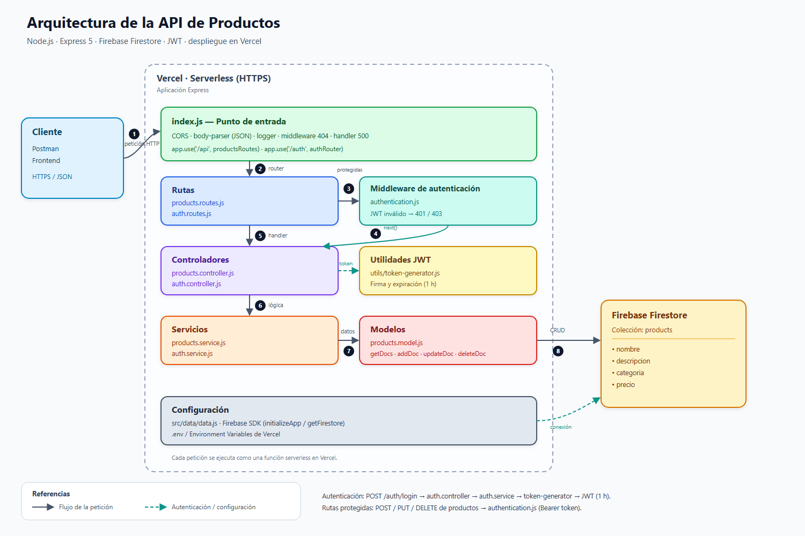

# API de Productos — Proyecto Final Node.js

## Bienvenido a mi API de productos



> Diagrama editable: [`docs/arquitectura.svg`](docs/arquitectura.svg). Vista previa de la portada: [`docs/portada.html`](docs/portada.html). También se muestra en la página desplegada: [proyecto-final-nodejs-mu.vercel.app](https://proyecto-final-nodejs-mu.vercel.app).

API REST para administrar el catálogo de productos de una tienda, construida con **Node.js + Express 5**, **Firebase Firestore** como base de datos en la nube y **JWT** para autenticación.

El proyecto sigue una arquitectura por capas (rutas → controladores → servicios → modelos), con middlewares para autenticación y manejo de errores, y configuración centralizada de servicios externos.

---

## Tabla de contenidos

- [Características](#características)
- [Tecnologías](#tecnologías)
- [Arquitectura](#arquitectura)
- [Estructura del proyecto](#estructura-del-proyecto)
- [Instalación](#instalación)
- [Variables de entorno](#variables-de-entorno)
- [Configuración de Firebase](#configuración-de-firebase)
- [Ejecución](#ejecución)
- [Autenticación](#autenticación)
- [Endpoints](#endpoints)
- [Ejemplos de uso](#ejemplos-de-uso)
- [Colección de Postman](#colección-de-postman)
- [Modelo de datos](#modelo-de-datos)
- [Códigos de estado y errores](#códigos-de-estado-y-errores)
- [Scripts disponibles](#scripts-disponibles)
- [Requerimientos cubiertos](#requerimientos-cubiertos)
- [Posibles mejoras](#posibles-mejoras)
- [Licencia](#licencia)

---

## Características

- CRUD de productos almacenados en **Firestore**:
  - Listar todos los productos.
  - Obtener un producto por ID.
  - Crear productos.
  - Actualizar productos.
  - Eliminar productos.
- Filtro opcional por categoría: `GET /api/products?category=alfajores`.
- Autenticación con **JWT** mediante `POST /auth/login`.
- Rutas de escritura (POST, PUT, DELETE) protegidas con token Bearer.
- Manejo de errores con códigos `400`, `401`, `403`, `404` y `500`.
- CORS habilitado para permitir peticiones desde cualquier origen.
- Arquitectura escalable separada en rutas, controladores, servicios, modelos y middlewares.

---

## Tecnologías

| Tecnología | Uso |
|---|---|
| [Node.js](https://nodejs.org/) (ES Modules) | Entorno de ejecución |
| [Express 5](https://expressjs.com/) | Servidor web y ruteo |
| [Firebase / Firestore](https://firebase.google.com/docs/firestore) | Base de datos en la nube |
| [jsonwebtoken](https://www.npmjs.com/package/jsonwebtoken) | Generación y verificación de JWT |
| [dotenv](https://www.npmjs.com/package/dotenv) | Variables de entorno |
| [cors](https://www.npmjs.com/package/cors) | Peticiones de origen cruzado |
| [body-parser](https://www.npmjs.com/package/body-parser) | Parseo de body JSON |
| [nodemon](https://www.npmjs.com/package/nodemon) | Reinicio automático en desarrollo |

> Requiere **Node.js 18 o superior** (recomendado Node.js 20+).

---

## Arquitectura

El diagrama completo está en la [portada de este README](#bienvenido-a-mi-api-de-productos) y en [`docs/arquitectura.svg`](docs/arquitectura.svg).

Una petición recorre este camino:

```
Cliente → Vercel/Express → Rutas → (Middleware JWT) → Controlador → Servicio → Modelo → Firestore
```

- **index.js**: configuración de Express, CORS, body-parser, logger, routers, 404 y errores.
- **Rutas**: definen los endpoints de productos y de login.
- **Middleware JWT**: protege POST, PUT y DELETE de productos.
- **Controladores**: validan la request y arman la respuesta.
- **Servicios**: concentran la lógica de negocio.
- **Modelos**: acceden a Firestore.
- **Utilidades**: generan y firman los tokens JWT.
- **Configuración**: inicializa Firebase y lee las variables de entorno.

> El diagrama está en `docs/arquitectura.svg` y se puede abrir en el navegador o editar como texto. La página `GET /` lo muestra incrustado en HTML; si modificás el SVG, regenerá la portada con `npm run portada`.

---

## Estructura del proyecto

```
ProyectoFinalNodeJS/
├── index.js                        # Punto de entrada: Express, CORS, middlewares, routers
├── package.json                    # Dependencias y scripts
├── .env                            # Variables de entorno reales (NO se versiona)
├── .env.example                    # Plantilla de variables de entorno
├── README.md
├── Requerimientos.pdf              # Consigna del proyecto
├── src/
│   ├── controllers/
│   │   ├── auth.controller.js      # Login
│   │   └── products.controller.js  # CRUD de productos
│   ├── data/
│   │   └── data.js                 # Inicialización y conexión con Firebase
│   ├── middlewares/
│   │   └── authentication.js       # Verificación del JWT (401 / 403)
│   ├── models/
│   │   └── products.model.js       # Acceso a Firestore
│   ├── routes/
│   │   ├── auth.routes.js          # POST /auth/login
│   │   └── products.routes.js      # Rutas de productos
│   ├── services/
│   │   ├── auth.service.js         # Lógica de validación del login
│   │   └── products.service.js     # Lógica de negocio de productos
│   └── views/
│       └── portada.js              # HTML de la portada (generado, no editar)
├── utils/
│   └── token-generator.js          # Firma del token JWT
├── scripts/
│   └── generar-portada.js          # Regenera src/views/portada.js desde el SVG
├── docs/
│   ├── arquitectura.svg            # Diagrama editable (fuente)
│   ├── arquitectura.png            # Imagen para README y visualización rápida
│   └── portada.html                # Vista previa de la portada (abrir en navegador)
└── postman/                         # Colecciones y entornos para probar la API
```

### Flujo de una petición

```
Cliente HTTP
    │
    ▼
index.js (CORS, body-parser, logger)
    │
    ▼
src/routes/*.routes.js  ──►  middleware de autenticación (rutas protegidas)
    │
    ▼
src/controllers/*.controller.js  (valida request / arma response)
    │
    ▼
src/services/*.service.js  (lógica de negocio)
    │
    ▼
src/models/*.model.js  ──►  Firebase Firestore
```

---

## Instalación

1. Clonar el repositorio o descargar el proyecto:

   ```bash
   git clone <url-del-repositorio>
   cd ProyectoFinalNodeJS
   ```

2. Instalar las dependencias:

   ```bash
   npm install
   ```

3. Crear el archivo `.env` a partir de la plantilla:

   ```bash
   # Linux / macOS
   cp .env.example .env

   # Windows (PowerShell)
   Copy-Item .env.example .env
   ```

4. Completar las variables con las credenciales de Firebase y una clave secreta para JWT (ver [Variables de entorno](#variables-de-entorno)).

---

## Variables de entorno

Todas las variables se cargan con `dotenv` desde el archivo `.env` en la raíz del proyecto.

| Variable | Obligatoria | Descripción |
|---|---|---|
| `FIREBASE_API_KEY` | Sí | API key de la app web de Firebase |
| `FIREBASE_AUTH_DOMAIN` | Sí | Dominio de autenticación (`<proyecto>.firebaseapp.com`) |
| `FIREBASE_PROJECT_ID` | Sí | ID del proyecto de Firebase |
| `FIREBASE_STORAGE_BUCKET` | Sí | Bucket de almacenamiento del proyecto |
| `FIREBASE_MESSAGING_SENDER_ID` | Sí | Sender ID de Firebase |
| `FIREBASE_APP_ID` | Sí | App ID de la app web de Firebase |
| `JWT_SECRET_KEY` | Sí | Clave secreta para firmar y verificar los tokens |
| `PORT` | No | Puerto del servidor (por defecto `3000`) |

Contenido de referencia del `.env`:

```env
FIREBASE_API_KEY=tu_api_key
FIREBASE_AUTH_DOMAIN=tu_proyecto.firebaseapp.com
FIREBASE_PROJECT_ID=tu_proyecto
FIREBASE_STORAGE_BUCKET=tu_proyecto.firebasestorage.app
FIREBASE_MESSAGING_SENDER_ID=000000000000
FIREBASE_APP_ID=1:000000000000:web:xxxxxxxxxxxxxxxx

JWT_SECRET_KEY=cambia_esta_clave_por_una_larga_y_segura

# Opcional
PORT=3000
```

> ⚠️ **Importante:** el archivo `.env` está incluido en `.gitignore` y nunca debe subirse al repositorio. Usá `.env.example` como documentación de las variables necesarias.

---

## Configuración de Firebase

1. Ingresar a [Firebase Console](https://console.firebase.google.com/) y crear un proyecto.
2. Habilitar **Firestore Database** (modo de prueba para desarrollo o reglas que permitan lectura/escritura).
3. Crear la colección `products` y agregar un primer documento con la estructura descripta en [Modelo de datos](#modelo-de-datos).
4. Registrar una **app web** en la configuración del proyecto y copiar los valores de `firebaseConfig` a las variables `FIREBASE_*` del `.env`.

La conexión se inicializa en `src/data/data.js`:

```js
const firebaseConfig = {
  apiKey: process.env.FIREBASE_API_KEY,
  authDomain: process.env.FIREBASE_AUTH_DOMAIN,
  projectId: process.env.FIREBASE_PROJECT_ID,
  storageBucket: process.env.FIREBASE_STORAGE_BUCKET,
  messagingSenderId: process.env.FIREBASE_MESSAGING_SENDER_ID,
  appId: process.env.FIREBASE_APP_ID
};
```

---

## Ejecución

```bash
# Producción / ejecución normal
npm start

# Desarrollo (reinicio automático con nodemon)
npm run dev
```

Salida esperada:

```
Servidor escuchando en http://localhost:3000
```

- URL base: `http://localhost:3000`
- API de productos: `http://localhost:3000/api`
- Login: `http://localhost:3000/auth`

---

## Autenticación

El login valida las credenciales contra el usuario de ejemplo definido en `src/services/auth.service.js` y devuelve un **Bearer token** firmado con `JWT_SECRET_KEY`, con una expiración de **1 hora**.

### Usuario de ejemplo

| Campo | Valor |
|---|---|
| Email | `user@email.com` |
| Password | `strongPass123` |

### Uso del token

Enviar el token en el header `Authorization` de las rutas protegidas:

```
Authorization: Bearer <token>
```

| Ruta | Protegida |
|---|---|
| `GET /api/products` | No |
| `GET /api/products/:id` | No |
| `POST /api/products/create` | **Sí** |
| `POST /api/products` (alias) | **Sí** |
| `PUT /api/products/:id` | **Sí** |
| `DELETE /api/products/:id` | **Sí** |
| `POST /auth/login` | No (es el login) |

Respuestas del middleware:

- **401** `{ "message": "Token no proporcionado" }` si no se envía el header.
- **403** `{ "message": "Token inválido" }` si el token es inválido o expiró.

---

## Endpoints

### Resumen

| Método | Ruta | Descripción | Auth |
|---|---|---|---|
| `GET` | `/` | Portada web (bienvenida + diagrama de arquitectura) | No |
| `POST` | `/auth/login` | Inicia sesión y devuelve el token | No |
| `GET` | `/api/products` | Lista todos los productos (filtro opcional por categoría) | No |
| `GET` | `/api/products/:id` | Obtiene un producto por ID | No |
| `POST` | `/api/products/create` | Crea un producto | Sí |
| `POST` | `/api/products` | Alias de creación (compatibilidad) | Sí |
| `PUT` | `/api/products/:id` | Actualiza un producto | Sí |
| `DELETE` | `/api/products/:id` | Elimina un producto | Sí |

---

### `POST /auth/login`

Valida las credenciales y devuelve un token JWT.

**Body:**

```json
{
  "email": "user@email.com",
  "password": "strongPass123"
}
```

**Respuesta `200`:**

```json
{
  "token": "eyJhbGciOiJIUzI1NiIsInR5cCI6IkpXVCJ9..."
}
```

**Errores:**

- `400` si falta `email` o `password`.
- `401` si las credenciales son inválidas.
- `500` si ocurre un error interno.

---

### `GET /api/products`

Devuelve todos los productos. Acepta el query param opcional `category`.

**Ejemplo:**

```
GET /api/products
GET /api/products?category=alfajores
```

**Respuesta `200`:**

```json
{
  "status": "success",
  "data": [
    {
      "id": "HIbCs03YXLrf2sdBwUvZ",
      "nombre": "Alfajor de Chocolate",
      "descripcion": "Dos tapas de chocolate artesanal...",
      "categoria": "alfajores",
      "precio": 2500
    }
  ]
}
```

> Si no hay productos, devuelve `200` con `data: []`.

---

### `GET /api/products/:id`

Devuelve el producto con el ID de Firestore indicado.

**Respuesta `200`:**

```json
{
  "message": "Producto encontrado",
  "data": {
    "id": "HIbCs03YXLrf2sdBwUvZ",
    "nombre": "Alfajor de Chocolate",
    "descripcion": "Dos tapas de chocolate artesanal...",
    "categoria": "alfajores",
    "precio": 2500
  }
}
```

**Errores:**

- `404` `{ "message": "Producto no encontrado" }`.
- `500` si Firestore no responde.

---

### `POST /api/products/create`

Crea un producto en Firestore. **Requiere token.**

**Body:**

```json
{
  "nombre": "Alfajor de Chocolate",
  "descripcion": "Dos tapas de chocolate artesanal rellenas de dulce de leche.",
  "categoria": "alfajores",
  "precio": 2500
}
```

**Respuesta `201`:**

```json
{
  "message": "Producto creado exitosamente",
  "data": {
    "id": "VEAmx0UkHFll7mMeqPla",
    "nombre": "Alfajor de Chocolate",
    "descripcion": "Dos tapas de chocolate artesanal rellenas de dulce de leche.",
    "categoria": "alfajores",
    "precio": 2500
  }
}
```

**Errores:**

- `400` si el body está vacío.
- `401` / `403` si falta el token o es inválido.
- `500` si Firestore no responde.

---

### `PUT /api/products/:id`

Actualiza parcialmente un producto. **Requiere token.** Solo se modifican los campos enviados.

**Body:**

```json
{
  "precio": 2800
}
```

**Respuesta `200`:**

```json
{
  "message": "Producto actualizado exitosamente",
  "data": {
    "id": "VEAmx0UkHFll7mMeqPla",
    "nombre": "Alfajor de Chocolate",
    "descripcion": "Dos tapas de chocolate artesanal rellenas de dulce de leche.",
    "categoria": "alfajores",
    "precio": 2800
  }
}
```

**Errores:**

- `400` si el body está vacío.
- `401` / `403` si falta el token o es inválido.
- `404` si el producto no existe.
- `500` si Firestore no responde.

---

### `DELETE /api/products/:id`

Elimina un producto. **Requiere token.**

**Respuesta `200`:**

```json
{
  "message": "Producto eliminado exitosamente",
  "data": "VEAmx0UkHFll7mMeqPla"
}
```

**Errores:**

- `401` / `403` si falta el token o es inválido.
- `404` si el producto no existe.
- `500` si Firestore no responde.

---

### `GET /`

Devuelve la **portada web del proyecto** con `Content-Type: text/html; charset=utf-8`: el mensaje «Bienvenido a mi API de productos», el diagrama de arquitectura incrustado y accesos rápidos a la API y al repositorio.

> El mensaje de bienvenida se mantiene dentro del HTML, por lo que la verificación del requisito sigue cumpliéndose. El HTML se genera desde `docs/arquitectura.svg` con `npm run portada`.

---

### Ruta no encontrada

Cualquier ruta no definida devuelve:

**`404`**

```json
{
  "error": "404 ruta no encontrada",
  "message": "El recurso /api/no-existe no existe"
}
```

---

## Ejemplos de uso

### 1. Login

```bash
curl -X POST http://localhost:3000/auth/login \
  -H "Content-Type: application/json" \
  -d "{\"email\":\"user@email.com\",\"password\":\"strongPass123\"}"
```

Guardar el token devuelto en una variable:

```bash
TOKEN="eyJhbGciOiJIUzI1NiIsInR5cCI6IkpXVCJ9..."
```

### 2. Listar productos

```bash
curl http://localhost:3000/api/products
```

### 3. Filtrar por categoría

```bash
curl "http://localhost:3000/api/products?category=alfajores"
```

### 4. Obtener un producto por ID

```bash
curl http://localhost:3000/api/products/HIbCs03YXLrf2sdBwUvZ
```

### 5. Crear un producto

```bash
curl -X POST http://localhost:3000/api/products/create \
  -H "Content-Type: application/json" \
  -H "Authorization: Bearer $TOKEN" \
  -d "{\"nombre\":\"Brownie de Chocolate\",\"descripcion\":\"Brownie artesanal.\",\"categoria\":\"brownies\",\"precio\":2800}"
```

### 6. Actualizar un producto

```bash
curl -X PUT http://localhost:3000/api/products/VEAmx0UkHFll7mMeqPla \
  -H "Content-Type: application/json" \
  -H "Authorization: Bearer $TOKEN" \
  -d "{\"precio\":3000}"
```

### 7. Eliminar un producto

```bash
curl -X DELETE http://localhost:3000/api/products/VEAmx0UkHFll7mMeqPla \
  -H "Authorization: Bearer $TOKEN"
```

> En Windows PowerShell, si `curl` está aliaseado a `Invoke-WebRequest`, usá `curl.exe` o `Invoke-RestMethod`.

---

## Colección de Postman

El proyecto incluye una colección lista para importar en `postman/API-Productos.postman_collection.json`.

### Importar en la extensión de Postman para VS Code

1. Abrir el panel de Postman en VS Code.
2. Clic en **Import** → **File**.
3. Seleccionar `postman/API-Productos.postman_collection.json`.
4. Ejecutar los requests en orden:
   - **1. Login**: guarda el token automáticamente en la variable `token`.
   - **4. Crear producto**: guarda el `id` en la variable `productId`.
   - Los demás requests reutilizan `{{token}}` y `{{productId}}`.

Variables de la colección:

| Variable | Valor |
|---|---|
| `baseUrl` | `http://localhost:3000` |
| `token` | Se completa al ejecutar el login |
| `productId` | Se completa al crear un producto |

Los scripts usan `pm.collectionVariables.set(...)`:

```js
// En el request de Login
const data = pm.response.json();
pm.collectionVariables.set("token", data.token);
```

> El token vence a la hora; si recibís `403 Token inválido`, volvé a ejecutar el login.

### Entornos (opcional)

La colección ya trae sus propias variables, así que **no es obligatorio crear un Environment**. Si preferís usar entornos, hay dos listos para importar:

- `postman/Vercel.postman_environment.json` → `baseUrl = https://proyecto-final-nodejs-mu.vercel.app`
- `postman/Local.postman_environment.json` → `baseUrl = http://localhost:3000`

Se importan igual que la colección (**Import → File**) y después se selecciona el entorno activo en el selector de entornos de Postman.

> Los entornos solo definen `baseUrl`. No agregues `token` ni `productId` en el entorno: si los definís vacíos, pueden sobrescribir las variables de colección que completan los scripts y las rutas protegidas fallarían con `401`.

---

## Modelo de datos

Colección de Firestore: **`products`**

| Campo | Tipo | Descripción |
|---|---|---|
| `nombre` | `string` | Nombre del producto (obligatorio al crear) |
| `descripcion` | `string` | Descripción del producto (opcional) |
| `categoria` | `string` | Categoría (ej. `alfajores`, `cookies`, `brownies`; opcional) |
| `precio` | `number` | Precio del producto (obligatorio al crear, ≥ 0) |

> Validación: `nombre` y `precio` son obligatorios en `POST /api/products/create`; en `PUT /api/products/:id` se puede enviar solo el campo a modificar. Los campos de texto no pueden estar vacíos y `precio` debe ser un número mayor o igual a 0.

> El `id` no se guarda como campo: Firestore genera el ID del documento y la API lo agrega a la respuesta como `id`.

**Documento de ejemplo:**

```json
{
  "nombre": "Alfajor de Chocolate",
  "descripcion": "Dos tapas de chocolate artesanal rellenas de dulce de leche y bañadas en chocolate semiamargo.",
  "categoria": "alfajores",
  "precio": 2500
}
```

> Se recomienda mantener `precio` siempre como número para evitar inconsistencias al filtrar u ordenar.

---

## Códigos de estado y errores

| Código | Significado | Ejemplo |
|---|---|---|
| `200` | OK | Listado, producto encontrado, actualización o eliminación correcta |
| `201` | Created | Producto creado |
| `400` | Bad Request | Body vacío o credenciales incompletas |
| `401` | Unauthorized | Token no proporcionado o credenciales inválidas |
| `403` | Forbidden | Token inválido o expirado |
| `404` | Not Found | Producto o ruta inexistente |
| `500` | Internal Server Error | Error de Firestore o error inesperado |

Los errores del listado de productos responden con:

```json
{
  "status": "error",
  "message": "Descripción del error"
}
```

Las rutas de autenticación y las operaciones sobre un producto devuelven:

```json
{
  "message": "Descripción del error"
}
```

Los errores no controlados pasan por el middleware global de `index.js`, que responde:

```json
{
  "status": "error",
  "message": "Error interno del servidor"
}
```

---

## Scripts disponibles

| Script | Comando | Descripción |
|---|---|---|
| `start` | `npm start` | Inicia el servidor con Node.js |
| `dev` | `npm run dev` | Inicia el servidor con nodemon (recarga automática) |
| `portada` | `npm run portada` | Regenera la portada HTML (`src/views/portada.js`) desde `docs/arquitectura.svg` |
| `test` | `npm test` | Placeholder (aún no hay tests automatizados) |

---

## Requerimientos cubiertos

- **#1 Configuración inicial:** `index.js`, `package.json` con `"type": "module"` y script `start`.
- **#2 Dependencias:** `express`, `cors`, `body-parser`, `dotenv`, `firebase`, `jsonwebtoken`.
- **#3 Configuración del servidor:** Express, CORS global, `body-parser` JSON, middleware 404 y archivo `.env`.
- **#4 Rutas:** productos (`GET`, `GET /:id`, `POST /create`, `PUT /:id`, `DELETE /:id`) y `POST /auth/login`.
- **#5 Controladores y servicios:** una capa de controladores y una de servicios para cada ruta.
- **#6 Acceso a los datos:** modelos conectados a Firestore.
- **#7 Rutas protegidas:** JWT, middleware de autenticación, login con validación y Bearer token.
- **Manejo de errores:** `400`, `401`, `403`, `404` y `500`.

---

## Posibles mejoras

- Mover los usuarios y credenciales a Firestore (hoy están hardcodeados como ejemplo).
- Hashear contraseñas con `bcrypt` en lugar de compararlas en texto plano.
- Agregar validación de esquemas con `zod`, `joi` o `express-validator`.
- Incorporar tests automatizados con Jest o Vitest + Supertest.
- Agregar paginación y ordenamiento al listado de productos.
- Configurar reglas de seguridad de Firestore acordes al entorno.
- Agregar rate limiting y helmet para seguridad en producción.
- Documentar la API con Swagger/OpenAPI.

---

## Licencia

ISC.
